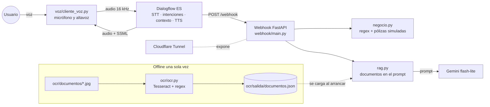

# Seguros Angel: asistente de voz con Dialogflow ES, OCR y LLM

Evaluación final de *Herramientas de IA Clásica*.

## Caso de uso

Seguros Angel atiende por teléfono a sus clientes de seguro de coche. El asistente, al que se le habla y que responde con voz, resuelve tres cosas: pedir una grúa de asistencia en carretera (flujo de varios turnos que recoge matrícula y ciudad, comprueba la póliza y termina con una confirmación sí/no), consultar datos de la póliza de una matrícula (coberturas, vencimiento, franquicia, prima) y responder preguntas sobre las condiciones generales a partir de cinco documentos escaneados procesados con OCR, diciendo explícitamente cuándo algo no aparece en ellos en vez de inventarlo.

## Arquitectura



El diagrama está en Mermaid (GitHub lo dibuja). Para la entrega se puede exportar a PNG en [mermaid.live](https://mermaid.live) y guardarlo como `docs/arquitectura.png`.

## Intenciones

Un único contexto, `ctx_grua_en_curso`, que gestiona el webhook.

| Intención | Propósito | Parámetros | Contexto |
| --- | --- | --- | --- |
| `Default Welcome Intent` | Saludo y lo que sabe hacer | – | – |
| `solicitar_grua` | Inicia el flujo de grúa | `matricula` (@matricula, regex, obligatoria), `ubicacion` (@sys.geo-city, obligatoria) | sale `ctx_grua_en_curso` |
| `solicitar_grua-si` | Confirma: abre el aviso con tiempo estimado según ciudad | – | entra y cierra `ctx_grua_en_curso` |
| `solicitar_grua-no` | Niega: ofrece corregir o cancelar | – | entra `ctx_grua_en_curso` |
| `corregir_dato` | Corrige matrícula o ciudad a mitad de flujo (extra) | `matricula`, `ubicacion` | entra `ctx_grua_en_curso` |
| `consultar_coberturas` | Coberturas de la póliza de una matrícula | `matricula` | – |
| `consultar_poliza` | Vencimiento, franquicia, prima o modalidad | `matricula`, `dato_poliza` (entidad propia) | – |
| `consultar_condiciones` | Preguntas sobre los documentos (OCR + LLM) | – | – |
| `hablar_con_agente` | Transferencia a agente humano con número de caso (extra) | – | cierra el contexto |
| `despedida` | Cierra la conversación | – | cierra el contexto |
| `Default Fallback Intent` | Lo no reconocido también va a la respuesta documental | – | – |

El export del agente (intenciones, entidades, frases de entrenamiento y contextos) está en `dialogflow/proyecto-aseguradora-api.zip`.

## Decisiones técnicas

**Voz.** Se usa el STT y el TTS nativos de Dialogflow en una sola llamada `detect_intent` con audio de entrada y de salida, con el modelo `latest_short` para frases cortas y una voz `es-ES-Neural2`. El webhook responde en SSML: pausas con `<break>`, matrículas y números de caso deletreados con `<say-as interpret-as="characters">`, fechas con `say-as date`, y entonación de pregunta con `<prosody>`. La variable `SSML=0` devuelve texto plano para probar en el simulador.

**Validación con regex en el webhook.** Aunque la entidad `@matricula` ya es una regex, el STT devuelve cosas como «1234 be ce de» o «1234-bcd». El webhook normaliza (mayúsculas, quita guiones y espacios, convierte letras deletreadas) y valida contra `^\d{4}[B-DF-HJ-NP-TV-Z]{3}$` (sin vocales, Ñ ni Q, como las matrículas actuales). La respuesta cambia según el resultado: formato inválido, matrícula sin póliza, póliza sin asistencia o petición de confirmación con los datos del vehículo.

**Contexto gestionado por el webhook.** El webhook guarda en `ctx_grua_en_curso` la matrícula y la ciudad ya validadas y un `estado`. Así la confirmación usa los datos validados y no los que entendió Dialogflow, y la corrección funciona aunque el usuario solo diga la matrícula nueva.

**OCR.** Los documentos son cinco imágenes de documentos ficticios de Seguros Angel (póliza, condicionado de asistencia, tabla de modalidades, procedimiento de siniestros y recibo), generadas por `ocr/generar_documentos.py` con giro, ruido y desenfoque de escáner. Son imágenes, no PDF con texto, así que la extracción es OCR real. Preprocesado en `ocr/ocr.py`:

1. Escala de grises, reescalado a 2.000 px de ancho, filtro de mediana contra el ruido y autocontraste.
2. Binarización con umbral de Otsu.
3. Enderezado por perfil de proyección (busca el giro que maximiza la varianza de la suma de tinta por fila).
4. Borrado de líneas de tabla (tramos negros de más de 120 px).
5. Si detecta una rejilla, lee la tabla celda a celda con `--psm 7` y la guarda como filas separadas por `|`. Si no, prueba `--psm 4` y `--psm 6` y se queda con el de mayor confianza media.

Leída de golpe, la tabla de modalidades salía ilegible (sopa de letras con `|` y `[`). Celda a celda sale entera salvo dos celdas («Sí» leído como «St» y «El»). Los errores sueltos de OCR se toleran porque el prompt avisa al LLM de que el texto viene de un OCR.

**Validación con regex sobre el OCR.** Se extraen matrículas, números de póliza, NIF, fechas, importes, teléfonos y referencias. No basta con que la regex encaje: la fecha tiene que existir en el calendario, el NIF tiene que tener la letra de control correcta y el importe se convierte a número. Lo que encaja pero no es válido se guarda en `descartados_por_validacion`. Antes de aplicar las regex se corrigen las confusiones típicas (O/0, l/1, S/5, B/8) solo cuando están pegadas a dígitos, y solo en la copia que va a las regex, nunca en el texto que se da al LLM.

**Respuesta documental sin alucinar.** El JSON se carga al arrancar el webhook (el OCR tarda unos 40 s y Dialogflow corta a los 5). Con cinco documentos (~3.500 caracteres) se envían todos en el prompt; no hace falta base vectorial ni filtrar por palabras clave, que fallaría con sinónimos («coche» frente a «vehículo»). El modelo tiene instrucción de responder la marca `NO_CONSTA` si la respuesta no está en los documentos, con temperatura 0, y el webhook la traduce a «Esa información no aparece en la documentación…». Probado con preguntas reales: remolque, tiempos de llegada, plazos de parte y precios se responden bien; «¿cubrís a mi mascota?», «horario de la oficina de Bilbao» o «el tiempo en Madrid» devuelven el mensaje de que no consta.

**Por qué no la Knowledge Base de Dialogflow.** Es beta, solo admite documentos con texto (no hace OCR), no permite controlar el prompt ni el mensaje cuando no hay respuesta, y no deja ver qué contexto se ha usado. Con el webhook controlamos las tres cosas.

**Modelo y latencia.** `gemini-3.5-flash-lite` responde en ~1 s con los documentos. Los modelos `flash` grandes dieron 503 por demanda o más de 10 s en las pruebas, inaceptable con el límite de 5 s. La llamada al LLM va en un hilo con un tiempo máximo (`LLM_TIMEOUT`, 3,5 s por defecto): si tarda o falla, el webhook responde «Ahora mismo no puedo consultar la documentación. ¿Quieres que te pase con un agente?» en lugar de dejar al usuario en silencio. El SDK no admite timeouts HTTP de menos de 10 s, por eso el corte es nuestro.

**Datos de negocio.** Las pólizas son un diccionario en `webhook/negocio.py` (cuatro matrículas). Coinciden con los documentos: la póliza AB-456789 del Seat León 1234 BCD y el recibo AB-456790 del Golf 5678 FGH.

## Ejecutar el proyecto

Requisitos: Python 3.12, [Tesseract](https://github.com/UB-Mannheim/tesseract/wiki) con el idioma español, una clave de Gemini y una cuenta de servicio con el rol *Dialogflow API Client*.

```bash
cd entrega
python -m venv .venv
.venv\Scripts\activate
pip install -r requirements.txt
copy .env.example .env
```

Rellena `.env` y después:

```bash
python ocr/generar_documentos.py
```

```bash
python ocr/ocr.py
```

```bash
pytest
```

```bash
uvicorn webhook.main:app --port 8000
```

En otra terminal, expón el puerto y pega la URL que muestra + `/webhook` en Dialogflow → Fulfillment:

```bash
cloudflared tunnel --url http://localhost:8000
```

Comprueba que llega abriendo la URL pública: debe responder `{"estado": "ok", "documentos_cargados": 5, ...}`. Por último, la conversación por voz:

```bash
python voz/cliente_voz.py
```

## Pruebas

`pytest` ejecuta 20 pruebas sin red: el flujo de la grúa con todos sus caminos (faltan datos, formato inválido, matrícula hablada, sin póliza, sin cobertura, confirmación sí y no, corrección de matrícula y de ciudad), las consultas, la respuesta documental con un LLM simulado (incluido el caso «no consta» y el de un LLM que tarda más del límite) y la validación de regex del OCR.

## Estructura

```
entrega/
├── webhook/        main.py (endpoint), negocio.py (regex, pólizas, SSML), rag.py (LLM)
├── ocr/            generar_documentos.py, ocr.py, documentos/, salida/documentos.json
├── voz/            cliente_voz.py
├── dialogflow/     el ZIP exportado del agente
├── docs/           guion_video.md
└── tests/
```
